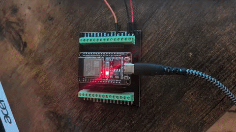
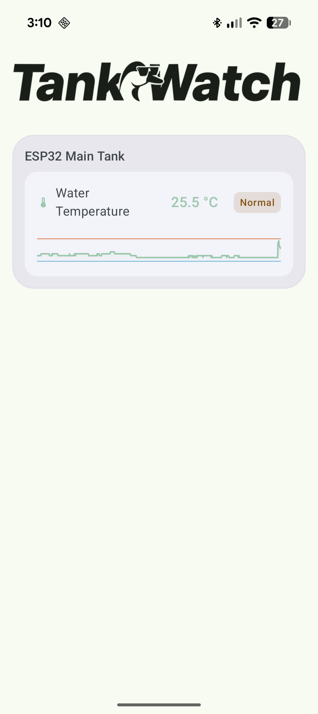
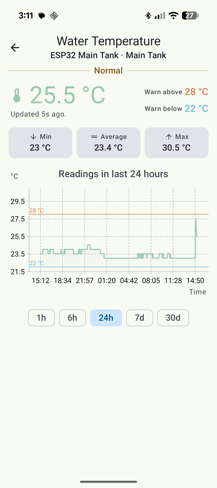

# TankWatch — Android

TankWatch is a personal IoT aquarium monitoring system. I'm building it to collect data to help me understand what's 'really' happening inside my aquarium. I hope for it to one day give me insight into why my fish and plants thrive.. or not. Plus it's a fun intersection between my interest in coding and fishkeeping.

Right now, the key features are:
- Visualizing historical sensor data through a mobile client app 
- Receiving alert notifications when sensor readings breach a configured threshold

The idea is sensors connected to an ESP32 board publish to an MQTT broker hosted in the cloud. The backend monitors incoming readings and alerts the mobile client when they breach their configured threshold. The backend also offers an API for the mobile client to gather historical sensor data.

This repo contains the native Android app: Kotlin, Jetpack Compose, Hilt, Retrofit, Vico charts, and Firebase Cloud Messaging.

**Related repos:** [tank_watch_server](https://github.com/garrettforsyth/tank_watch_server) · [tankwatch-firmware](https://github.com/garrettforsyth/tankwatch-firmware)

---

## Demo



---

## Screenshots


| Dashboard | Sensor Detail |

 


---

## Overview
Currently, the app has two main pages: the dashboard page gives a quick overview of tanks, sensors, and readings (via sparkline). Tapping a sensor card or breach notification will navigate to the sensor details screen where historical sensor data may be viewed.

Roadmap:
- Additional sensor support: water level, total dissolved solids (TDS), pH
- Authentication: intend on using Clerk
- Device provisioning flow
- Sensor configuration

## Features

- **Dashboard** — live sensor cards per tank with sparkline charts and temperature status indicators
- **Sensor Detail** — full time-series chart with colored min/max threshold lines, range filter (1h → 30d), and min/avg/max stat cards
- **FCM push notifications** — threshold breach alerts with deeplink directly to the affected sensor's detail screen
- **Mallard duck color scheme** — custom Material 3 theme (deep forest green, steel blue, amber)

---

## Tech Stack

| | |
|---|---|
| Language | Kotlin |
| UI | Jetpack Compose + Material 3 |
| Architecture | MVVM, `StateFlow`, `UiState` pattern |
| DI | Hilt |
| Networking | Retrofit + OkHttp + kotlinx-serialization |
| Charts | Vico 3.x |
| Navigation | Navigation Compose (type-safe routes) |
| Push notifications | Firebase Cloud Messaging |
| Min SDK | API 26 (Android 8.0) |

---

## Getting Started

### Prerequisites

- A running TankWatch server (see [tank_watch_server](https://github.com/garrettforsyth/tank_watch_server)) or access to the production VPS

### 1. Clone the repo

```bash
git clone https://github.com/garrettforsyth/tankwatch-android
```

### 2. Configure the API base URL

In `NetworkModule.kt`, set `BASE_URL` to your server's address:

```kotlin
private const val BASE_URL = "https://tankwatch.duckdns.org/"
```

For local development, use your machine's local IP (not `localhost` — the emulator can't resolve it):

```kotlin
private const val BASE_URL = "http://192.168.x.x:3000/"
```

### 3. Add google-services.json

Download `google-services.json` from the [Firebase Console](https://console.firebase.google.com) and place it at:

```
tankwatch-android/app/google-services.json
```

This file is gitignored. Without it the project will not build.

### 4. Build and run

Open the project in Android Studio and run on a device or emulator.

> **Note:** FCM push notifications require a Google Play Services image. Use a **Google Play** emulator, not a standard one. Physical devices work without any special configuration.

---

## Project Structure

```
com.garrettforsyth.tankwatch/
├── data/
│   ├── remote/dto/         ← API response DTOs with toDomain() extensions
│   ├── model/              ← domain models (Device, Sensor, Reading, SensorConfig)
│   └── repository/         ← TankWatchRepository interface + impl
├── di/                     ← Hilt modules (network, repository)
├── manager/                ← TankWatchNotificationManager (FCM channel + routing)
├── service/                ← TankWatchFirebaseMessagingService
├── navigation/             ← type-safe Destinations + NavGraph
├── ui/
│   ├── dashboard/          ← DashboardScreen, DashboardViewModel, SensorCard
│   ├── sensordetail/       ← SensorDetailScreen, SensorDetailViewModel, StatCard
│   ├── sensorconfig/       ← SensorConfigScreen, SensorConfigViewModel
│   ├── main/               ← tab scaffold, MainViewModel (FCM deeplink state)
│   └── theme/              ← Color, Theme, Type, Dimensions
└── util/                   ← Resource<T>, TemperatureFormatter, ValueFormatter
```